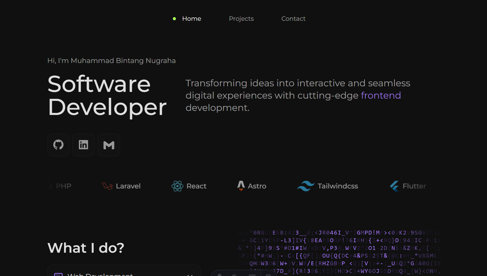

# Muhammad Bintang Nugraha — Developer Portfolio

<div align="center">



<br />

[](https://bintangnugraha.my.id/)
[](https://github.com/bintangnugrahaa/portfolio/actions/workflows/ci.yml)
[](LICENSE)
[](https://nodejs.org/)

<p align="center">
  A high-performance personal developer portfolio and interactive showcase built with <strong>Astro</strong>, <strong>React</strong>, <strong>Tailwind CSS</strong>, and <strong>Firebase Firestore</strong>.
</p>

</div>

---

## Table of Contents

- [Overview](#overview)
- [Key Features](#key-features)
- [Architecture & Project Structure](#architecture--project-structure)
- [Getting Started](#getting-started)
  - [Prerequisites](#prerequisites)
  - [Installation](#installation)
  - [Environment Configuration](#environment-configuration)
  - [Development & Build Scripts](#development--build-scripts)
- [Usage & Customization](#usage--customization)
  - [Adding New Showcase Projects](#adding-new-showcase-projects)
  - [Configuring the Real-Time Like Counter](#configuring-the-real-time-like-counter)
  - [Configuring the Contact Form](#configuring-the-contact-form)
- [Configuration Reference](#configuration-reference)
- [Roadmap](#roadmap)
- [Contributing](#contributing)
- [License & Contact](#license--contact)

---

## Overview

This repository contains the source code for the personal portfolio website of **Muhammad Bintang Nugraha**. The application utilizes Astro's Islands Architecture to deliver maximum delivery speeds via pre-rendered Static Site Generation (SSG), while seamlessly hydrating selective client-side islands powered by React for interactive Canvas animations and real-time state persistence.

---

## Key Features

- **⚡ Zero-JS Static Site Generation (SSG)**: Core pages and layouts are compiled directly into static HTML/CSS with minimal runtime footprint.
- **🏝️ Astro Islands Hydration**: React components (`LetterGlitch`, `LikeButton`, `SkillsList`) hydrate selectively on the client side (`client:load`, `client:visible`).
- **🎨 Custom Canvas Letter Glitch Simulation**: High-performance canvas-based matrix glitch background rendering configurable speeds and color palettes.
- **❤️ Real-Time Firestore Counter**: Optimistic UI like button synchronized bi-directionally with Google Firebase Firestore and persisted locally across sessions.
- **📱 Responsive & Accessible UI**: Dark-themed aesthetic styled with Tailwind CSS, supporting custom variable typography (`@fontsource-variable/montserrat`) and fluid scrollbar interactions.
- **🔍 Comprehensive SEO & Metadata**: Includes OpenGraph tags, Twitter cards, canonical URLs, and structured Schema.org JSON-LD data for maximum discoverability.
- **🚀 Automated CI Pipeline**: GitHub Actions workflow executing dependency verification, TypeScript type checking, and production builds on push/PR.

---

## Architecture & Project Structure

The project adheres to the standard Astro file-based architecture, decoupling static presentation components from interactive React client islands:

```text
portfolio/
├── .github/
│   ├── workflows/          # GitHub Actions (CI build & type-check)
│   ├── dependabot.yml      # Automated dependency update configuration
│   └── FUNDING.yml         # Sponsor and funding metadata
├── public/                 # Static assets served as-is (images, svgs, fonts, robots.txt)
│   ├── fonts/              # Preloaded variable font assets
│   ├── svg/                # Tech stack vector assets
│   └── og.image.png        # Social card preview image
├── src/
│   ├── components/         # Pure Astro presentation components
│   │   ├── contact.astro   # Contact section & Formspree AJAX handler
│   │   ├── footer.astro    # Footer with social links & Spotify embed
│   │   ├── home.astro      # Hero section with headline and action links
│   │   ├── logoWall.astro  # Infinite CSS marquee for tech stacks
│   │   ├── nav.astro       # Responsive desktop & mobile header navigation
│   │   └── projects.astro  # Showcase card grid for deployed projects
│   ├── layouts/
│   │   └── Layout.astro    # Base HTML document, head meta tags, and global styles
│   ├── pages/
│   │   └── index.astro     # Root application entry point
│   ├── React/              # Interactive client islands (React 19)
│   │   ├── LetterGlitch.tsx # Interactive canvas glitch effect
│   │   ├── LikeButton.tsx   # Real-time Firestore like counter button
│   │   └── SkillsList.tsx   # Expandable skill set accordion
│   ├── env.d.ts            # Ambient TypeScript definitions for Astro client
│   └── firebase.ts         # Firebase SDK client initialization
├── .env.example            # Template for environment variables
├── astro.config.mjs        # Astro integration & Vite alias settings
├── tailwind.config.mjs     # Tailwind CSS token configurations
├── tsconfig.json           # TypeScript configuration
└── package.json            # Project manifest, dependencies, and scripts
```

---

## Getting Started

Follow these steps to set up the project locally for development and testing.

### Prerequisites

Ensure your development environment meets the following requirements:

- **Node.js**: `v20.0.0` or higher (recommended: Node `v22.x LTS`)
- **Package Manager**: [`pnpm`](https://pnpm.io/) `v11.x` (or `npm` `v10+` / `bun`)
- **Git**: For version control management

Verify versions on your system:

```bash
node -v
pnpm -v
```

### Installation

1. **Clone the repository:**

   ```bash
   git clone https://github.com/bintangnugrahaa/bintangnugraha.my.id.git
   cd bintangnugraha.my.id
   ```

2. **Install project dependencies:**

   ```bash
   pnpm install
   # Or alternatively:
   # npm install
   ```

3. **Set up environment variables:**

   ```bash
   cp .env.example .env
   ```

> [!NOTE]
> For local layout and styling verification, Firebase credentials can remain empty. Firebase credentials are only required if you wish to sync live likes with Firestore.

### Environment Configuration

Open `.env` in your editor and provide your Firebase configuration if testing the like counter:

```bash
PUBLIC_FIREBASE_API_KEY="AIzaSy..."
PUBLIC_FIREBASE_AUTH_DOMAIN="your-app.firebaseapp.com"
PUBLIC_FIREBASE_PROJECT_ID="your-app"
PUBLIC_FIREBASE_STORAGE_BUCKET="your-app.appspot.com"
PUBLIC_FIREBASE_MESSAGING_SENDER_ID="1234567890"
PUBLIC_FIREBASE_APP_ID="1:1234567890:web:abcdef"
```

### Development & Build Scripts

The following npm scripts are defined in `package.json`:

| Command | Action | Description |
| :--- | :--- | :--- |
| `pnpm dev` | `astro dev` | Starts local dev server at `http://localhost:4321` with Hot Module Replacement (HMR). |
| `pnpm build` | `astro check && astro build` | Runs TypeScript diagnostics via `@astrojs/check` and generates static production output in `dist/`. |
| `pnpm preview` | `astro preview` | Locally serves the pre-built `dist/` directory to test production builds. |
| `pnpm astro` | `astro` | Runs the Astro CLI directly for diagnosing routes or running sync. |

To start the local development server:

```bash
pnpm dev
```

---

## Usage & Customization

### Adding New Showcase Projects

Showcase items are managed in [`src/components/projects.astro`](src/components/projects.astro). Add a new object to the `projects` array:

```typescript
interface Project {
  title: string;
  image: string;
  link: string;
  preview: string;
  status: string;
}

const projects: Project[] = [
  // ... existing projects
  {
    title: "Project Alpha",
    image: "/projects/alpha.png",
    link: "https://github.com/bintangnugrahaa/project-alpha",
    preview: "https://alpha.example.com",
    status: "Deployed",
  },
];
```

Place corresponding preview images in the `public/` directory (e.g., `public/projects/alpha.png`).

### Configuring the Real-Time Like Counter

The like button uses Firebase Cloud Firestore. Ensure your Firestore database contains a document at:

- **Collection:** `likes`
- **Document ID:** `counter`
- **Field:** `likes` (Number, default `0`)

Rules snippet for public counter read/write:

```javascript
rules_version = '2';
service cloud.firestore {
  match /databases/{database}/documents {
    match /likes/counter {
      allow read: if true;
      allow update: if request.resource.data.likes == resource.data.likes + 1;
    }
  }
}
```

### Configuring the Contact Form

The contact form in [`src/components/contact.astro`](src/components/contact.astro) uses [Formspree](https://formspree.io/):

1. Register on Formspree and obtain your unique form endpoint.
2. Update the `action` attribute in the `<form>` tag:
   ```html
   <form id="contact-form" action="https://formspree.io/f/YOUR_FORM_ID_HERE" method="POST">
   ```

---

## Configuration Reference

Astro requires the `PUBLIC_` prefix for any environment variable consumed by client-side browser code:

| Variable | Required | Description | Example |
| :--- | :--- | :--- | :--- |
| `PUBLIC_FIREBASE_API_KEY` | Optional | Web API key from Firebase project settings | `AIzaSyD-abc123...` |
| `PUBLIC_FIREBASE_AUTH_DOMAIN` | Optional | Authentication domain for Firebase | `project-id.firebaseapp.com` |
| `PUBLIC_FIREBASE_PROJECT_ID` | Optional | Unique Firebase project identifier | `portfolio-bintang` |
| `PUBLIC_FIREBASE_STORAGE_BUCKET`| Optional | Cloud Storage bucket URL | `portfolio-bintang.appspot.com` |
| `PUBLIC_FIREBASE_MESSAGING_SENDER_ID` | Optional | Numeric sender ID for Cloud Messaging | `987654321098` |
| `PUBLIC_FIREBASE_APP_ID` | Optional | Unique web application instance ID | `1:98765:web:abcd` |

---

## Roadmap

- [x] Responsive layout with mobile-first navigation drawer
- [x] Interactive WebGL canvas matrix glitch background
- [x] Real-time like counter with Firestore and local caching
- [x] Continuous scrolling logo marquee for skills & technologies
- [x] Automated CI validation pipeline via GitHub Actions
- [ ] Blog / Articles section powered by Astro Content Collections
- [ ] Light / Dark dynamic theme switcher with persistent token storage
- [ ] Dynamic GitHub commit activity graph integration
- [ ] Lighthouse score performance badge automation

---

## Contributing

Contributions, issues, and feature requests are welcome. To ensure code quality and consistency across commits:

1. **Fork the repository** on GitHub.
2. **Create a feature branch:**
   ```bash
   git checkout -b feat/add-new-feature
   ```
3. **Commit your changes** following [Conventional Commits](https://www.conventionalcommits.org/):
   ```bash
   git commit -m "feat: add interactive project filter tag"
   ```
4. **Ensure clean build and type verification:**
   ```bash
   pnpm run build
   ```
5. **Push to the branch:**
   ```bash
   git push origin feat/add-new-feature
   ```
6. **Open a Pull Request** describing your additions or fixes.

---

## License & Contact

Distributed under the **MIT License**. See [`LICENSE`](LICENSE) for detailed terms.

### Maintainer

**Muhammad Bintang Nugraha**
- **Website**: [bintangnugraha.my.id](https://bintangnugraha.my.id)
- **GitHub**: [@bintangnugrahaa](https://github.com/bintangnugrahaa)
- **LinkedIn**: [in/bintangnugraha](https://www.linkedin.com/in/bintangnugraha)
- **Email**: [muhammadbintangnugraha18@gmail.com](mailto:muhammadbintangnugraha18@gmail.com)

<div align="center">
  <sub>Built with ❤️ using Astro & React. Designed with clean engineering standards.</sub>
</div>
